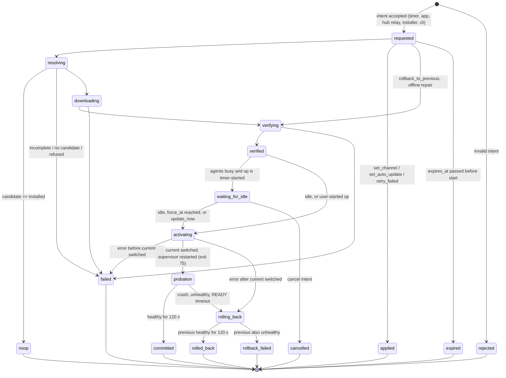

# Bridge supervisor engine (launcher + supervisor)

Status: **spec, for review** (chain `chain_18ea9cf21732bfc6`, task T9). Implemented by
T10 (launcher), T11 (resolver), T12 (download/verify/unpack), T13 (journal, activation,
probation, rollback), T14 (agent gate) and tested by T15. Written against `v0.5.74`
(`60c3af8b`); `file:line` references are to that tree.

Sources: design report `artifact://art_18ea9c7966f4666c` §6.2–§6.6 (target design), §7
(phases), §8 (risks); work breakdown `artifact://art_18ea9db18c151848` §3, §7; installer
contract `docs/specs/bridge-installer-contract.md` (T1); release manifest
`docs/release-signing.md` (T5). User decisions from T0 (chain summary) override the report
where they differ; each override is marked **[T0]**.

Requirements served: `REQ-ONE-1` (one update path), `REQ-SRC-1` (GitHub only), `REQ-CHAN-1`
(per-bridge channel, no silent downgrade), `REQ-ISO-1` (independent management),
`REQ-OS-1` (Linux incl. Fedora Atomic, macOS, Windows).

Keywords: **must**, **must not**, **may** are normative. Everything here is **PROPOSAL**
unless it cites current code.

## 0. Decisions this spec fixes

| # | Question (brief) | Decision |
|---|---|---|
| D1 | Process model | OS service → **launcher** (long-lived parent, no policy) → **supervisor** (engine) → runtime `ham-bridge` + `ham-pty-host` (children of the supervisor). §2. |
| D2 | Who restarts after a switch | The supervisor never upgrades itself in place. Every activation ends with the old supervisor exiting `75`; the launcher starts the supervisor of the new `current` tree. The self-upgrade path is therefore exercised on **every** update, not only when the supervisor changed. §8. |
| D3 | Launcher fallback | Deadline-based: while `current` ≠ `known-good`, the launcher starts `previous` in fallback mode if the `current` supervisor does not READY within 30 s, exits with anything but 0/75 (78 included), or `known-good` has not become `current` within `T_commit` = 270 s of launch (covers hangs). Comparison of three records re-read before every start; no journal parsing. §7. |
| D4 | Pointer mechanism | Linux/macOS: symlinks `current`/`previous` replaced with `rename(2)` + directory `fsync`. Windows: record files `current.json`/`previous.json` replaced with `ReplaceFileW` (fallback `MoveFileExW(REPLACE_EXISTING\|WRITE_THROUGH)`). §4. |
| D5 | Snapshot or refuse on schema mismatch | **Both, by rule:** activation always snapshots the registered schema-bearing state (never credentials); the snapshot is **restored on rollback only when the previous release cannot read what the candidate writes**. Activation is **refused** when a needed snapshot cannot be taken, when an explicit downgrade crosses a state-schema boundary the older release cannot read, or when journal schemas differ by more than one. §11. |
| D6 | Agent gate **[T0 Q3]** | Timer-started updates wait **up to 2 h** for this instance's agents, showing a countdown, then force. A user-started update (`update_now`, `install_version`, `rollback_to_previous`, `repair`), or an `update_now` sent during the wait, interrupts immediately. §12. |
| D7 | Stable resolution | `GET /repos/{owner}/{repo}/releases/latest` plus the per-target asset and manifest check, never a list page (report §6.4; same rule as T1 §5.1 as approved at `1b2ba52d`). Fast = highest SemVer, paged to exhaustion **[T0 Q2]**. §13. |
| D8 | Launcher upgrades | The engine **never** replaces the launcher. Launcher ABI is frozen at 1 for Phase 1; a release needing a newer launcher is refused with `launcher_abi_too_old` and the launcher is replaced only by a `ham-bridge setup` transaction (installer, app, Phase 2 conversion), which has today's external verify/rollback. §7.4. |
| D9 | Recovery of an unstartable instance (T1 §7 deferral) | `ham-supervisor repair` — the same engine code, under the instance lock, journaled as action `repair`, installing a bundle the caller already downloaded and that the engine verifies with the same manifest rules. §16. |

## 1. Scope

In scope: what one bridge instance's launcher and supervisor store, accept, decide and do,
on every OS, including crash recovery. Out of scope: the hub relay and UI (Phase 3), Phase 2
conversion of today's `bin/` installs (only its preconditions are fixed here: §3 ownership record, §7.4, §16), uninstall
details beyond reserving the action, Termux (no bundle, report F8), always-on mode (dropped,
**[T0 Q4]**).

**Phase 1 is dormant** (report §7, Phase 1): launcher and supervisor ship in the bundle but
are not the service entry point. In Phase 1 the engine runs only against test roots and
`ham-supervisor` CLI invocations made by tests; it **must not** touch a real instance's
`bin/`, service definition, `.install.lock` or the user-wide `~/.heimdall-auto-update.lock`
(`src/bridge/auto_update.odin:411-413`). Today's update paths keep working unchanged.

## 2. Processes and ownership

```
OS service (systemd --user unit | LaunchAgent | Scheduled Task)   written once per instance
 └─ ham-launcher            <data>/launcher/        frozen; reads pointers; no network
     └─ ham-supervisor      <data>/releases/<C>/    the engine; holds the instance lock
         ├─ ham-bridge      <data>/releases/<C>/    runtime (hub connection, agents)
         └─ ham-pty-host    <data>/releases/<C>/    PTY host + agent process trees
```

- Runtime and PTY host are **always** started from the same tree as the supervisor that
  starts them. Today the PTY host outlives the service and may run from `bin.bak*`
  (`src/bridge/setup_pty_host.odin:3-9`, report F5); in the target design it is a child of the
  supervisor and dies with it.
- Process identity is `(pid, start_time)` (Linux `/proc/<pid>/stat` field 22, macOS
  `proc_pidinfo` `pbi_start_tvsec/usec`, Windows `GetProcessTimes` creation time). The
  supervisor records every process it starts in `supervisor/procs.json` (pid, start_time,
  process group / job name, role, tree; written by atomic replace) immediately after the
  spawn returns; it signals only processes whose pair matches.
- Windows: the supervisor puts the runtime and PTY host in a **job object it creates**
  (nested jobs, Windows 8+) with `JOB_OBJECT_LIMIT_KILL_ON_JOB_CLOSE`, so stopping the
  instance is `TerminateJobObject` on that job, cannot reach another instance, and the job
  dies with the supervisor even if it crashes. The launcher does the same for the
  supervisor (§7.3). Today no job objects exist in `src/` (grep `CreateJobObject` → none).
- POSIX: each child is started in its own process group; stop = `SIGTERM` to the group,
  `SIGKILL` after the grace period (§12).

### 2.1 No orphans after a supervisor crash

A supervisor can die without stopping its children (crash, `SIGKILL`, OOM). On POSIX the
children are in their own process groups and would be reparented and keep running, and a
second runtime would then start with the same credentials (report F5 again). Three
independent layers prevent this; all are **required**:

1. **Lifeline.** The supervisor passes each child a lifeline pipe (read end, inherited only
   by that child). The runtime and the PTY host must exit when it reaches EOF, and the PTY
   host must first terminate the process groups (POSIX) / job (Windows) of the agents it
   hosts. Works on every OS, including macOS, which has no parent-death signal.
2. **Kernel help where available.** Linux: children set `prctl(PR_SET_PDEATHSIG, SIGKILL)`
   and then check `getppid()` still equals the supervisor's pid (race guard). Windows:
   `KILL_ON_JOB_CLOSE` on the supervisor's job (above).
3. **Reap at start (J0, §6.3).** Every supervisor start, before READY and before starting
   any runtime, terminates every `procs.json` entry whose `(pid,start_time)` is still alive
   (process group `SIGTERM` → 10 s → `SIGKILL`, or `TerminateJobObject` on a job opened by
   name), waits until each has exited (max 30 s), then empties `procs.json`. A survivor
   after 30 s → the supervisor exits 78 (`orphan_unkillable`) without starting a runtime.

Handles: `engine.lock`'s fd/handle, the READY pipe's write end and every lifeline end the
supervisor keeps are opened `O_CLOEXEC` / non-inheritable (`bInheritHandles` only through an
explicit `PROC_THREAD_ATTRIBUTE_HANDLE_LIST`), so no child can hold the instance lock or
keep the READY pipe open.

## 3. On-disk layout

Roots are today's (`src/lib/bridgesvc/bridgesvc.odin:216-228`): `<data>` =
`~/.local/share/heimdall/bridges/<svc>/` (Windows `%LOCALAPPDATA%\heimdall\bridges\<svc>\`);
`<state>` = `~/.config/heimdall/bridges/<svc>/` (Windows `%APPDATA%\heimdall\bridges\<svc>\`).
`<svc>` is today's service name `heimdall-bridge-<hub>[_<profile>]`
(`bridgesvc.odin:188-191`).

```
<data>/
  instance.json                ownership record (below)                       mutable, rare
  launcher/
    ham-launcher[.exe]         frozen launcher; never written by the engine (D8)
    launcher.json              {"abi":1,"version":"0.6.0","sha256":"…"}
  releases/
    <ver>-<d12>/               IMMUTABLE release tree, <d12> = first 12 hex of bundle SHA-256
      ham-supervisor[.exe] ham-bridge[.exe] ham-pty-host[.exe] ham-ctl[.exe] ham-launcher[.exe] …
      extensions/              bundled provider extensions
      release.json             the verified manifest, byte-for-byte as signed
      release.json.minisig     its signature
      tree.json                {"files":[{"path","size","sha256"}…]} written by the engine at unpack
      .complete                written last, after every file + tree.json is fsynced
    .staging-<op_id>/          unpack target; renamed once to <ver>-<d12>/ (§5 W3)
    .trash-<ver>-<d12>/        GC in progress (§15)
  current  | current.json      pointer to the active tree (§4)
  previous | previous.json     pointer to the fallback tree (§4)
  known-good.json              {"tree":"<ver>-<d12>","committed_op":"<op_id>","at":<unix>}
  supervisor/
    engine.lock                OS lock held by the live supervisor (§9)
    journal/ops.jsonl          append-only operation journal (§6)
    journal/ops.1.jsonl        one rotated generation
    intents/inbox/<op_id>.json queued intents (§10)
    snapshots/<op_id>/         state snapshot for an activation (§11)
    downloads/<op_id>/         manifest, signature, bundle .part
    procs.json                 processes started by this supervisor (pid, start_time, role, tree)
    pins.json                  failed candidates {version, sha256, op_id, reason, at}
    resolver.json              ETag / Last-Modified cache, next_check_at, rate-limit reset
  bridge/ shell_sessions/ run/ logs/ …   runtime data, as today (not moved by this spec)
<state>/
  config.toml ports.json hub-url profile bridge-token* runtime-status.json   as today (bridgesvc.odin:32-39)
  update.json                  {"channel":"stable|fast","auto_update":true,"revision":n,"actor":"…","updated_at":<unix>}
  supervisor-status.json       last published supervisor status (journal head + countdown), owner-only
```

**Ownership record** `instance.json` (written at install or Phase 2 conversion, never by a
normal update):

```json
{"schema":1,"instance_id":"ins_<32 hex random>","service_name":"heimdall-bridge-hub-brolabs-ai_tanmay",
 "hub_url":"https://hub.brolabs.ai","profile":"tanmay","owner":{"uid":1000},
 "data_root":"…","state_root":"…","layout":1,"created_at":1795400000}
```

`owner` is `{"uid":n}` on POSIX and `{"sid":"S-1-5-21-…"}` on Windows. `instance_id` is
stable across re-enrollment (the bridge id may change on S4 re-enroll, T1 §3) and is the
`instance_id` in every intent. A supervisor whose effective uid/SID or root path differs
from the record refuses to run (`ownership_mismatch`); this is how a bridge never manages
another OS user's bridge **[T0 Q8]**.

Permissions: `<data>/supervisor/`, `<state>/` and every snapshot are `0700` / owner-only
(Windows: inherited per-user profile ACL, no explicit grant to others). Release trees are
`0755` dirs and `0755`/`0644` files, written by the owner only.

## 4. Pointers

A pointer names a release tree by its directory name `<ver>-<d12>`. A pointer is **valid**
when it parses, names a directory under `releases/` that contains `.complete`, and the
tree's `release.json` version and digest prefix match the name.

### 4.1 Linux and macOS: symlinks

- `current` and `previous` are relative symlinks `releases/<ver>-<d12>`.
- Switch `P` to tree `T`: `symlink("releases/T", "P.tmp-<op_id>")`; `rename("P.tmp-<op_id>",
  "P")`; `fsync(<data> dir fd)`. `rename(2)` replaces the link atomically: a reader sees the
  old or the new target, never neither. A crash can leave `P.tmp-*`; it is deleted at
  supervisor start.
- Readers use `readlink` on `current`/`previous`, never a resolved path cached across a
  switch. Provider registrations and the tray that need a stable path use the `current`
  link path, not the resolved tree.
- APFS (macOS) and ext4/btrfs/xfs (Linux; btrfs on Fedora Atomic `/var/home`) all give
  atomic `rename(2)` of a symlink within one directory. Verify on Fedora Atomic and macOS in
  T15 (report §8.1: `/var/home` writability is a HYPOTHESIS).

### 4.2 Windows: record files

Symlinks need Developer Mode or `SeCreateSymbolicLinkPrivilege`, and a junction cannot be
replaced atomically, so Windows uses records:

- `current.json` / `previous.json` = `{"tree":"<ver>-<d12>","op_id":"…","seq":n,"crc32":"…"}`,
  UTF-8, `crc32` over the canonical JSON without the `crc32` member.
- Switch: write `current.json.tmp-<op_id>`, `FlushFileBuffers`, close; `ReplaceFileW(
  current.json, tmp, NULL, REPLACEFILE_IGNORE_MERGE_ERRORS, …)`. If `current.json` does not
  exist yet, or `ReplaceFileW` fails with `ERROR_UNABLE_TO_MOVE_REPLACEMENT*`, use
  `MoveFileExW(tmp, current.json, MOVEFILE_REPLACE_EXISTING | MOVEFILE_WRITE_THROUGH)`.
- Readers open with `FILE_SHARE_READ | FILE_SHARE_WRITE | FILE_SHARE_DELETE`, read, close
  immediately, and **retry** on `ERROR_SHARING_VIOLATION` / `ERROR_ACCESS_DENIED` (antivirus,
  backup tools) with 50 ms → 1 s backoff for up to 10 s. A record that fails to parse or
  whose `crc32` mismatches is invalid.
- `seq` increases by one on every write of either record; the larger `seq` wins if a
  recovery ever finds two plausible records (diagnostics only; the journal is authoritative
  for in-flight operations).

### 4.3 Order of a switch

Activation from `F` (from) to `T` (to) always writes, in this order:
1. journal `activating/pointers_begin` (fsynced),
2. `previous := F`,
3. `current := T`,
4. journal `activating/pointers_done`.

Rollback writes `current := F` (and leaves `previous = F`). `known-good.json` is written
(same atomic replace as §4.2 on every OS) only on `committed` or `rolled_back`.

## 5. Windows file-in-use rules

Windows does not let a loaded executable or DLL be deleted or overwritten, and refuses to
rename a directory while any file in it is open (today's `bin/` swap fails this way,
`src/bridge/setup_cmd.odin:381-389`; report F11, HYPOTHESIS for the cause of real
failures). The engine therefore follows these rules on **every** OS (so the code paths and
tests are identical), and they are **required** on Windows:

| # | Rule |
|---|---|
| W1 | **Never rename, move, overwrite or delete anything inside a live tree.** A tree is *live* if it is `current`, `previous`, `known-good`, the `to`/`from` of the active operation, or the tree of any process in `procs.json` whose `(pid,start_time)` is still alive. |
| W2 | A release tree directory is renamed **at most once**: `.staging-<op_id>` → `<ver>-<d12>`, before **any** process has executed from it (the `--version` preflight runs from the final tree, after the rename, §14 steps 9–11). `.complete` is written only after that preflight's processes have exited. Nothing is ever renamed *into* a live tree name; a leftover final tree without `.complete` that is not live is deleted (W5) before the rename is retried. |
| W3 | The staging rename and every pointer replace retry on `ERROR_SHARING_VIOLATION` / `ERROR_ACCESS_DENIED` / `ERROR_LOCK_VIOLATION` with backoff 100 ms → 2 s for up to 60 s total (antivirus scanning freshly written files, report Phase 1 test "antivirus delay"). On exhaustion the operation fails **before** the point of no return (`fs_busy`), the staging dir stays for GC, the installed version keeps running. |
| W4 | Switching versions changes only the pointer records. Old trees keep their files; processes still running from them (e.g. a tray, a straggler) keep working until they exit. |
| W5 | GC deletes a non-live tree by renaming it to `.trash-*` then deleting; a delete or rename that fails because something is open leaves the tree (or trash) in place, marked by its presence, retried at the next supervisor start. No `MOVEFILE_DELAY_UNTIL_REBOOT` (needs admin). |
| W6 | The engine never writes `launcher/`. The launcher executable is in use for the life of the service (D8). |
| W7 | Before activation the supervisor stops every process it started from the `from` tree (job object terminate) **and waits until each handle reports exit**. This is not needed to free files (W1 forbids touching them) but guarantees no old PTY host survives (report F5). |
| W8 | The engine never relies on `schtasks /Run` to restart itself; restarts happen inside the launcher (§7), which sidesteps `MultipleInstancesPolicy=IgnoreNew` (`src/lib/bridgesvc/render.odin:154`, report F12 HYPOTHESIS). |
| W9 | Downloaded files are written to `supervisor/downloads/<op_id>/` with a `.part` suffix and renamed only after the size and SHA-256 match; extraction reads the final file. |

## 6. Operation journal

### 6.1 Format

`supervisor/journal/ops.jsonl`: one JSON object per line, appended with a single `write`
of the whole line followed by `fsync` (Windows `FlushFileBuffers`) **before** the action
the line announces is taken (write-ahead), except terminal lines, which are written after.

```json
{"js":1,"seq":4182,"ts":1795400123,"op_id":"op_7f3c…","action":"update_now","actor":"app:usr_18…",
 "state":"activating","sub":"pointers_begin",
 "from":{"version":"0.5.74","sha256":"…","tree":"0.5.74-1a2b3c4d5e6f"},
 "to":{"version":"0.5.75","sha256":"…","tree":"0.5.75-9f8e7d6c5b4a"},
 "force_at":null,"probation_attempt":1,"error":null,"crc32":"0c1d2e3f"}
```

- `js` = journal schema (manifest field `journal_schema`, T5). This spec defines **1**.
- A line whose `crc32` mismatches or that does not end with `\n` is a torn write: it and
  everything after it is ignored (and truncated at start).
- The **active operation** is the last `op_id` whose last line is not terminal.
- Rotation: when `ops.jsonl` exceeds 1 MiB at supervisor start (no active op), the
  supervisor (1) writes `ops.jsonl.new` with the final line of every op terminal within the
  last 31 days (at least the last 50), fsyncs it; (2) replaces `ops.1.jsonl` with
  `ops.jsonl` (rename / `MoveFileExW REPLACE_EXISTING|WRITE_THROUGH`); (3) renames
  `ops.jsonl.new` → `ops.jsonl`; fsyncs the directory. Recovery (J33): `ops.jsonl` missing
  and `.new` present → finish step 3; both present → delete `.new` and redo. A supervisor
  reads journal schema `N` and `N-1`, writes `N` (report §8.3).
- **Op index** `supervisor/journal/op-index.json`: `{op_id: {state, at}}` for every op that
  reached a terminal state (including `rejected`) within the last **31 days** (longer than the
  30-day intent horizon, §10), written by atomic replace **after** the terminal journal line
  and reconciled from both journal files at every start (a terminal line missing from the
  index is added). It is the dedupe authority: an intent whose `op_id` is in the index is
  answered with the recorded state and never runs again, however old the journal is.
  Intents whose `created_at` is more than 30 days in the past are rejected `stale_intent`,
  so nothing older than the index can arrive.
- The journal is the single durable result of an operation; status sent to the app or hub is
  derived from it and is never inferred from a reconnect (fixes report F3).

### 6.2 States

Non-terminal: `requested`, `resolving`, `downloading`, `verifying`, `verified`,
`waiting_for_idle`, `activating`, `probation`, `rolling_back`.
Terminal: `committed`, `noop`, `applied`, `failed`, `cancelled`, `expired`, `rejected`,
`rolled_back`, `rollback_failed`.

`failed` is added to the report's diagram: any error **before the point of no return**
(the `current` switch) ends there with the installed version untouched and running.
`noop` = resolved candidate equals installed (report diagram `resolved → committed`, renamed
so the UI does not claim an update happened). `applied` closes a configuration op
(`set_channel`, `set_auto_update`, `retry_failed`). `rejected` closes an intent that failed
validation (§10). `cancelled`/`expired` close intents that never ran.

Which path each action takes:

| Action | Path |
|---|---|
| `update_now`, timer tick, `install_version`, `repair` (intent) | full diagram |
| `check_now` | `requested → resolving → noop` (with the available candidate) or `failed` |
| `rollback_to_previous` | `requested → verifying` (local tree re-check, no network) `→ verified →` gate `→ activating → …` as an install with `to` = `previous` |
| `set_channel`, `set_auto_update`, `retry_failed` | `requested → applied` (J27) |
| offline `ham-supervisor repair` (CLI) | `requested → verifying → verified → activating` (no gate: service stopped) `→ handover`; probation by the service's supervisor (J29) |
| invalid intent | `rejected` (single line, J31) |



`activating` sub-steps, in order (each journaled before it runs): `gate_closed` →
`stopping` → `stopped` → `snapshot` → `pointers_begin` → `pointers_done` → `handover`.
`probation` sub-states: `probation` (attempt *k*) and `probation_suspended` (§7.5).
`rolling_back` sub-steps: `stopping` → `stopped` → `pin` → `pointers` → `restore` →
`handover` → `probation`.

### 6.3 Transitions and crash-recovery outcomes

"Crash" = the supervisor process dies, the machine loses power, or the OS kills the service
at any instant during the step. "Recovery" = what the next supervisor start does after
reading the journal under the instance lock. Every row is a T13/T15 failure-injection point.
The launcher's part of recovery is §7.

| # | Transition / step | Durable effect of the step | Crash during or right after → recovery outcome |
|---|---|---|---|
| J0 | **Every supervisor start**, before anything below and before READY | Take `engine.lock`; reap every live `procs.json` entry (§2.1 layer 3); finish an interrupted rotation (J33); reconcile `op-index.json`; delete `*.tmp-*` pointer leftovers | Crash during reaping: the next start reaps again (idempotent; entries are removed only after their process is confirmed gone). Survivor after 30 s → exit 78 (`orphan_unkillable`); the launcher treats 78 like a crash for the fallback rule (§7.2), and a known-good instance stays offline with that reason in `launcher-status.json` rather than running two runtimes. |
| J1 | intent → `requested` | Line appended; intent file deleted **after** the line | Line missing: intent file still in inbox → re-read, same `op_id` (idempotent). Line present, intent file still there → file deleted, op continues. `op_id` already in `op-index.json` → file deleted, nothing runs. |
| J2 | `requested` → `expired` | Terminal line | Re-evaluated: still expired → terminal written. |
| J3 | `requested` → `resolving` | Line; HTTP requests | Restart resolution from scratch (idempotent; ETag cache may give 304). |
| J4 | `resolving` → `noop` / `failed` | Terminal line | None needed; if the line is missing, resolution reruns and reaches the same verdict. |
| J5 | `resolving` → `downloading` | Line naming `to` (version, sha256 from manifest) | Delete `downloads/<op_id>/*.part`; restart the download (no Range resume; bundles are ~tens of MB). If `releases/<to.tree>/.complete` already exists (same digest), skip to `verified`. |
| J6 | `downloading` → `verifying` | Bundle `.part` renamed to final after size+SHA-256 (W9) | Re-verify the final file from the start (signature, size, SHA-256, archive safety); delete `releases/.staging-<op_id>` if present and unpack again. |
| J7 | `verifying` → `verified` | Order (§14 steps 8–11): staging written + `tree.json` + fsync → rename to `<to.tree>` → preflight from the final tree, wait for its processes to exit → `.complete` + fsync | `.staging-<op_id>` present → delete it, redo J6. Final tree present **without** `.complete` and not live (W1) → delete (W5), redo J6; deletion blocked → `failed fs_busy` (GC retries later). Final tree with `.complete` and matching `tree.json` sizes → `verified`. Rename failed after W3 retries → `failed fs_busy`. |
| J8 | `verified` → `waiting_for_idle` | Line with absolute `force_at` (unix seconds) | Resume waiting with the **same** `force_at`. If the wall clock moved back so that `force_at − now > 2 h`, clamp `force_at = now + 2 h` and journal it. Agents were never stopped, nothing to undo. |
| J9 | `waiting_for_idle` → `cancelled` | Terminal line | Nothing to undo (admission was never closed for long, §12). Tree `to` stays for GC. |
| J10 | `verified`/`waiting_for_idle` → `activating/gate_closed` | Launch admission closed in the runtime (in-memory) | On restart the runtime is restarted fresh (admission open). If `current` ≠ `to`: the op is **not** past the point of no return → write `failed interrupted_before_switch` (the installed version is restarted as normal); a timer op is retried at the next tick, a user op is reported and must be re-sent. |
| J11 | `activating/stopping` → `stopped` | Agents, PTY host, runtime of `from` stopped (pids in `procs.json`) | Children die with the supervisor (lifeline, `PR_SET_PDEATHSIG`, job kill-on-close, §2.1) and any survivor is reaped by J0 before READY. Then as J10: `failed interrupted_before_switch`, `from` restarted. |
| J12 | `activating/snapshot` | `snapshots/<op_id>/` written, fsynced, `snapshot.json` written last | Same as J10; incomplete snapshot (no `snapshot.json`) deleted. |
| J13 | `activating/pointers_begin` → `previous := from` | `previous` replaced | `current` still = `from` → outcome as J10 (`previous` = `from` is harmless). |
| J14 | `current := to` (**point of no return**) | `current` replaced | If `current` = `to`: continue as J15. If `current` = `from` (replace did not land): as J10. Torn/invalid `current`: launcher uses `previous` (= `from`, §7); that supervisor sees the active op with `current` invalid and writes `current := from`, outcome `failed pointer_write`. |
| J15 | `activating/pointers_done` → `handover` | Supervisor exits 75 | Launcher re-reads the records and starts the supervisor of `current` = `to` (§7). It reads the active op: `activating`, `current` = `to` = its own tree → writes `probation` (attempt 1) and starts runtime + PTY host from `to`. |
| J15a | Crash **between** `pointers_done` and exit 75 (`from` supervisor dies with `current` = `to`) | — | The launcher sees a crash of a supervisor it started while `C` was `from` (= `K`). It re-reads all records before restarting (§7.2): now `C` = `to` ≠ `K` → starts `to` in normal mode with a fresh `T_commit` deadline → J15. It never restarts the tree it last launched without re-reading. |
| J16 | `probation` (attempt *k*) | Runtime + PTY host of `to` running; 120 s window (§14) | **`to` supervisor crash or hang while the launcher lives** → launcher fallback (§7.2): it terminates `to`'s job/group and starts `previous` in fallback mode → J18. **Machine or launcher restart** (power loss, crash of the whole service, no `probation_suspended` line) → the next start of `to` writes `probation` attempt *k+1* and restarts the window from zero; after 3 such unclean attempts → `rolling_back probation_interrupted` (repeated power loss is indistinguishable from a candidate that kills the machine; the pin is cleared by `retry_failed`). |
| J16a | `probation` → `probation_suspended` (service stop, logout, reboot, §7.5) | Line written, children stopped, exit 0 | Next start of `to` resumes probation with the **same** attempt number and a full 120 s window; clean stops never count toward the 3-attempt limit. Line missing (stop killed the supervisor before it wrote it) → treated as J16 machine restart. |
| J17 | `probation` → `committed` | `known-good := to`, then terminal line | `known-good` = `to` but line missing → write `committed` at start. `known-good` ≠ `to` → still probation (J16). |
| J18 | `probation`/`activating(after switch)` → `rolling_back` | Line with reason | Resume rolling back from the first sub-step whose effect is not observed (each sub-step is idempotent, below). |
| J19 | `rolling_back/stopping` → `stopped` | Processes of `to` stopped | Children died with the crashed supervisor (§2.1); J0 at the next start reaps survivors before anything else; continue at J20. |
| J20 | `rolling_back/pin` | `pins.json` gains `{to.version, to.sha256}` | Re-adding an existing pin is a no-op. |
| J21 | `rolling_back/pointers` | `current := from` | Re-check `current`; write again if ≠ `from`. |
| J22 | `rolling_back/restore` | Snapshot copied back (only if required, §11.3), per file via temp + atomic replace, `restored` marker last | Marker missing → restore again from the start (idempotent: snapshot files are never modified). |
| J23 | `rolling_back/handover` | The `to` supervisor (if it is the one rolling back) exits 75 | Launcher re-reads pointers: `current` = `from`, and `known-good` is still `from` (it never advanced), so the launcher starts `from` in normal mode; a `from` that then crashes is a known-good crash loop (§7.2), never another fallback. The `from` supervisor continues at J24. If the rollback is already run by the `from` supervisor (launcher fallback), there is no handover. |
| J24 | `rolling_back/probation` → `rolled_back` | 120 s healthy, `known-good := from` (unchanged), terminal line with the original reason | Crash: restart the window (max 3 attempts as J16). |
| J25 | `rolling_back/probation` → `rollback_failed` | Terminal line; runtime restart attempts stop | Terminal. The supervisor stays up, keeps the local endpoint and `supervisor-status.json` current, accepts only `repair`, `rollback_to_previous`, `install_version`, `cancel`, `check_now` intents. |
| J26 | any non-terminal state, op is user-started and `expires_at` passes **before** `activating` | `expired` | As J2. After `activating/gate_closed` expiry is ignored (the op is past its start). |
| J27 | `set_channel` / `set_auto_update` / `retry_failed`: `requested` → `applied` | Order: `requested` line → `update.json` / `pins.json` replaced atomically, carrying `"last_op":"<op_id>"` → `applied` line → op index | File not yet written (`last_op` ≠ `op_id`) → write it (for `set_channel`, `revision` = stored + 1 only in this case, so a replay never bumps twice). File written, `applied` missing → write `applied`. |
| J28 | `rollback_to_previous`: `requested` → `verifying` → `verified` | `previous` valid and ≠ `current`; tree `tree.json` sizes match (read-only check, no network) | Rerun the check (read-only). Check fails → `failed no_previous` / `tree_damaged` (status suggests `repair`). From `verified` on, identical to an install with `from` = `current`, `to` = `previous` (J10–J25); at `activating/pointers_begin` the newer tree `from` is pinned (`user_rollback`) so the timer does not re-install it; `retry_failed` clears the pin. |
| J29 | Offline `ham-supervisor repair` (CLI, §16) | Holds `.install.lock` (setup) + `engine.lock`; service stopped. Lines: `requested` → `verifying` → `verified` → `activating` sub-steps `stopped` (J0 reap only) → `snapshot` → `pointers_begin` → `previous := current` if valid else the new tree → `current := new` → `pointers_done` → `handover`; CLI exits 0, releasing the locks; setup starts the service | Before the CLI starts its own op it runs J0 and resolves any active op exactly as a supervisor start would. CLI crash before `current := new` → the active op ends `failed interrupted_before_switch` at the next CLI run or supervisor start, and setup reports exit 1 (re-runnable). CLI crash after `current := new` → the service's supervisor of `new` (launched with `C` = `new` ≠ `K`) finds `activating` with `current` = its tree → J15/J16 probation → `committed`, `known-good := new`. `new` fails → launcher fallback to `previous` (may itself be broken → offline, setup reports the result it saw, exit 1/7). |
| J30 | `update_now` arrives while the active op is `waiting_for_idle` (supersede) | Order: active op line `activating/gate_closed` with `"interrupted_by":"<new op_id>"` → new op single line `noop superseded_by <active op_id>` → op index → inbox file deleted | Crash after the first line: the inbox file is still there; on re-read the active op is past waiting → new op closes `noop superseded_by` (same result). Crash before the first line: the active op is still waiting and the intent is re-read → same outcome. |
| J31 | Invalid intent (`wrong_instance`, `unknown_action`, `bad_expiry`, `stale_intent`, `expired`, schema error) | Single terminal line `rejected <reason>` → op index → inbox file deleted | File still there → `op_id` found in the index → file deleted, nothing re-journaled. A file that does not parse or has no `op_id` is renamed to `inbox/bad-<ts>.json`, not journaled, and GC deletes it after 7 days. |
| J32 | Supervisor start whose launch does not match the records (§7.6) | Decision taken after J0 and the journal read, before READY and before starting any runtime | The supervisor exits 75 or rolls back per §7.6. A crash during the decision repeats it at the next start (it is read-only until the rollback line is written, after which J18 applies). |
| J33 | Journal rotation (§6.1) | `ops.jsonl.new` → replace `ops.1.jsonl` → rename `.new` | J0 finishes or redoes the rotation; the op index is never touched by rotation, so dedupe history survives any crash in it. |

Terminal states need no recovery. On start, after the active op (if any) is resolved, the
supervisor runs GC (§15) and processes the inbox.

## 7. Launcher

### 7.1 Inputs and contract

`ham-launcher --instance-root <data> --state-root <state>`; nothing else. It reads only
`instance.json` (to check owner), `current`, `previous`, `known-good.json`. It has **no
network, channel, download, journal or manifest logic** (report §6.3). It writes only
`<data>/launcher-status.json` (last decision, last supervisor exit, crash count) via atomic
replace, for diagnostics.

Supervisor start: `releases/<T>/ham-supervisor run --instance-root … --state-root …
--launched-tree <T> --launch-mode normal|fallback`, with an inherited pipe (POSIX fd 3 /
Windows inherited handle, number passed as `--ready-fd`). The supervisor must write
`READY <T> <engine_version> <journal_schema>\n` once it holds the instance lock, has run J0
(orphan reaping), has taken the §7.6 decision and has finished journal recovery up to the
point where it starts the runtime (§6.3), and within **30 s** (`T_ready`). A supervisor that
exits 75 under §7.6 does so without writing READY.

Supervisor exit codes the launcher understands:

| Code | Meaning | Launcher action |
|---|---|---|
| 0 | Service stop requested (SIGTERM/stop) | Exit 0 |
| 75 | Restart into `current` (handover, or a launch that did not match the records, §7.6) | Clear the in-memory fallback flag, re-read the records, apply §7.2; no crash counted |
| 78 | Refuses to run (ownership mismatch, lock held, orphan unkillable) | While `C` ≠ `K`: a failure for §7.2 (fallback). While `C` = `K`: sleep 60 s, exit 78 (service manager restarts with its own backoff) |
| other / signal | Crash | Rule 7.2 |

### 7.2 Fallback rule (D3)

Before **every** start (first start, after exit 75, after a crash) the launcher re-reads
all three records; it never restarts "the tree it launched last" without doing so.

```
loop:
  C = valid(current) ? current : none
  P = valid(previous) ? previous : none
  K = valid(known-good) ? known-good : none

  if fallback_flag:                     start P (fallback mode); on crash restart P with backoff
  elif C == none:                       start P in fallback mode, else K (normal), else wait 60 s, exit 78
  elif C == K:                          start C (normal); on crash restart with backoff 1 s → 5 min, unbounded
  else:                                 # C is unproven
      deadline[C] = deadline[C] or now + T_commit     # kept per C value across exit-75 restarts
      start C (normal)
      watch: every 5 s re-read known-good
        known-good == C                 → C is proven; keep supervising as C == K
        no READY within 30 s            → fail
        exit 0                          → exit 0 (service stop)
        exit 75                         → clear fallback_flag, goto loop
        any other exit (78 included)    → fail
        now ≥ deadline[C]               → fail (hang or endless probation)
      fail: terminate C's job / process group, wait for exit,
            if P != none and P != C: fallback_flag = true, goto loop
            else restart C with backoff (no better tree exists)
```

- `T_commit` = `T_ready` (30 s) + runtime ready (60 s) + probation (120 s) + margin (60 s) =
  **270 s** from launch (§19). Probation restarts after a clean suspend (J16a) happen in a
  new launcher process, so they get a new deadline.
- **Fallback never alternates.** Once `fallback_flag` is set, the launcher only starts `P`
  until a supervisor exits 75. A `P` that reaches READY decides everything else from the
  journal and the records (§7.6).
- A known-good crash loop leaves the bridge offline: the card shows "offline since …"; only
  `repair` from the installer or app can fix it (report §6.10). The launcher never deletes
  or edits pointers.

### 7.3 Signals and stop

(See §7.5 for what the supervisor does with the stop.)

- POSIX: on SIGTERM/SIGINT the launcher forwards SIGTERM to the supervisor's process group
  and waits up to 20 s, then SIGKILL, then exits 0. The new systemd unit uses
  `KillMode=control-group` (today `KillMode=process`, `src/lib/bridgesvc/render.odin:117`,
  report F6) so nothing survives a stop; this is a Phase 2 render change.
- Windows: the launcher owns a job object containing the supervisor (which nests its own
  job, §2) with `JOB_OBJECT_LIMIT_KILL_ON_JOB_CLOSE`; ending the scheduled task kills the
  launcher, the job handle closes, the whole instance tree dies, and nothing of another
  instance is in that job.
- macOS: LaunchAgent `KeepAlive.SuccessfulExit=false` (today, `render.odin:127`) restarts the
  launcher only on non-zero exit, matching 7.1.

### 7.4 Launcher ABI (D8)

`launcher.json.abi` = 1. A manifest field `min_launcher_abi` (§13.4) above the installed ABI
makes the candidate ineligible (`launcher_abi_too_old`, reported, not pinned). The launcher
is installed or replaced only by `ham-bridge setup` (Phase 2 conversion and later), which
re-renders the service definition and keeps the previous launcher directory until the new
one has reported a supervisor READY, using setup's existing verify/rollback
(`src/bridge/setup_cmd.odin:620-687`). Self-initiated launcher replacement by the engine
is deliberately not designed in Phase 1.

### 7.5 Service stop in the middle of an operation

A stop (SIGTERM / task end / logout / reboot / setup stopping the service) reaches the
supervisor through the launcher (§7.3). The supervisor has 15 s (the launcher waits 20 s)
and does, by state:

| State at stop | Supervisor action before exit 0 | Next start |
|---|---|---|
| `requested`, `resolving`, `downloading`, `verifying` | Abort the HTTP / unpack step; no line | Rerun the step (J3–J7) |
| `verified`, `waiting_for_idle` | No line; `force_at` is already durable | Resume (J8); the 2 h deadline is wall-clock and keeps running |
| `activating`, before `current := to` | Line `failed service_stopped`; stop children | `from` starts normally; a timer op retries at the next tick |
| `activating`, after `current := to` | Finish `pointers_done` (bounded, no I/O beyond the journal); stop children | `to` starts → probation attempt 1 (J15) |
| `probation` | Line `probation_suspended` (attempt unchanged); stop children | J16a: same attempt, full window |
| `rolling_back` | Finish the current sub-step if it is `pointers` or `restore` (bounded), journal it; stop children | Resume at the next sub-step (J18–J24) |
| terminal / idle | Stop children | Normal start |

If the supervisor is killed before it writes the line, the next start treats the stop as a
crash (J10–J24 rows apply).

### 7.6 Launch–record mismatch (supervisor side)

After J0 and reading the journal, before READY-side effects (starting a runtime), a
supervisor launched with `--launched-tree L --launch-mode M` compares with the records
`C`, `K`:

| Case | Action |
|---|---|
| `M` = normal, `L` = `C` | Normal: continue the active op or run idle. |
| `M` = normal, `L` ≠ `C` | The records changed since the launcher read them. Exit 75 without starting a runtime. |
| `M` = fallback, `L` = `C` | Already rolled back (or `C` = `P`); behave as normal. |
| `M` = fallback, `C` = `K` ≠ `L` | The candidate committed before the launcher gave up (e.g. crash right after J17). Exit 75; the launcher clears its fallback flag and starts `C` normally. |
| `M` = fallback, `C` ≠ `K`, `C` ≠ `L`, active op with `to` = `C` | Roll back (J18): `from` must equal `L`; if it does not, roll back to `L` anyway and record `from_mismatch`. |
| `M` = fallback, `C` ≠ `K`, `C` ≠ `L`, no active op (journal lost, or `K` missing on a fresh install) | Write a synthetic op `rollback_to_previous actor supervisor reason launcher_fallback` (from = `C`, to = `L`), pin `C`, and run it through J18–J24. |

All cases are T15 tests (J32).

## 8. Supervisor self-upgrade contract

The supervisor is updated like any file in the tree (D2):

1. The **old** supervisor (`from`) does everything up to and including the pointer switch
   (§6.2 `activating`), then exits 75.
2. The launcher starts the **new** supervisor (`to`). It must READY within 30 s and then
   run probation of its own runtime + PTY host.
3. If the new supervisor cannot READY, exits with anything but 0/75, or does not make
   `known-good` = `to` within `T_commit`, the launcher terminates it and starts the old one
   in fallback mode, which reads the journal and rolls back (J18–J24, §7.6).

Compatibility obligations every supervisor release must meet (checked by T15 with N-1 and
N+1 builds):

| Item | Obligation |
|---|---|
| Journal | Read `js` N and N-1; write N. Activation refused if `|to.journal_schema − from.journal_schema| > 1` (`journal_schema_gap`). |
| Intents | Intent schema 1 is read forever; changes are additive (unknown fields ignored, unknown actions rejected per §10). |
| Lock | Same lock path and kind (§9) in every version. |
| READY | Same handshake line; extra trailing fields allowed. |
| Pointers / records | Same formats (§4); a new format needs a new `layout` in `instance.json` and a setup transaction, never an engine update. |
| `min_engine` | A release declares the oldest engine allowed to install it (T5 field). Candidate eligible only if `ENGINE_VERSION(running) ≥ candidate.min_engine`. This spec sets `ENGINE_VERSION = 1`; a release whose `min_engine` is 0 has no supervisor and is **never** installed by the engine (`no_engine`). |
| Fallback mode | A supervisor started with `--launch-mode fallback` must be able to roll back from any `to` whose journal schema is within one of its own. |

## 9. Locks and concurrency

- `supervisor/engine.lock`: held for the whole life of a supervisor process and by
  `ham-supervisor repair` (POSIX `flock(LOCK_EX|LOCK_NB)` on an open fd; Windows
  `LockFileEx(LOCKFILE_EXCLUSIVE_LOCK|LOCKFILE_FAIL_IMMEDIATELY)` on byte 0). The kernel
  releases it when the process dies; there is no stale-lock breaking. A second supervisor
  that cannot take it exits 78. One lock **per instance**; the user-wide
  `~/.heimdall-auto-update.lock` (`src/bridge/auto_update.odin:411-413`) is not used and is
  deleted in Phase 4 (report R8).
- `ham-bridge setup` on a supervisor-managed instance keeps its own `.install.lock`
  (`src/lib/bridgesvc/setup.odin:191`). Lock order is **`.install.lock` then
  `engine.lock`**, never the reverse.
- One operation at a time per instance. §10 says how intents arriving during an operation
  coalesce.

## 10. Intents (format and queue)

```json
{"is":1,"op_id":"op_<26 char ULID>","instance_id":"ins_…","action":"update_now",
 "channel":null,"version":null,"expires_at":1795486523,"actor":"app:usr_18e0…",
 "created_at":1795400123}
```

| Field | Rule |
|---|---|
| `is` | Intent schema, 1. |
| `op_id` | Unique, chosen by the sender; also the journal op id. Re-sending the same `op_id` is idempotent for at least 31 days (returns the recorded state from the op index, §6.1). |
| `instance_id` | Must equal `instance.json.instance_id`; else rejected `wrong_instance` (never forwarded). |
| `action` | One of the table below; else rejected `unknown_action`. |
| `channel` | Only for `set_channel`: `stable` \| `fast`. |
| `version` | Only for `install_version`: a tag (`v0.5.75`). |
| `expires_at` | Unix seconds, required. Rejected if already past (`expired`) or more than 30 days ahead (`bad_expiry`). Queued offline intents use it (report §6.8 "Queued, not applied"). |
| `created_at` | Unix seconds, required. Rejected `stale_intent` if more than 30 days in the past. |
| `actor` | `timer` \| `app:<user_id>` \| `hub:<user_id>` \| `installer` \| `cli` \| `supervisor`. `timer` and `supervisor` are written only by the supervisor itself. |

| `action` | Effect |
|---|---|
| `check_now` | Resolve only; report "available"; no install. |
| `update_now` | Resolve per channel and install if newer; **user-started** (interrupts, D6). Timer ticks create the same op with `actor: timer`. |
| `install_version` | Install exactly `version` (explicit; downgrade allowed only here, §13.2). User-started. |
| `rollback_to_previous` | Activate `previous` (no download; the tree is re-checked against `tree.json` sizes; the newer tree is pinned, J28). User-started. |
| `set_channel` | Write `update.json` with `revision+1`; acknowledged in the journal; no install (report §6.4 "fast → stable"). |
| `set_auto_update` | Toggle the timer in `update.json`. |
| `cancel` | Cancel the active op if it is before `activating/gate_closed`; otherwise rejected `past_point_of_no_return`. |
| `retry_failed` | Remove the pin for `version` so the timer may try it again. |
| `repair` | Re-install `known-good`'s release from GitHub through the full engine (§16). User-started. |
| `uninstall` | Reserved; defined with Phase 3/4 (report §6.6 Removal). Rejected `not_implemented` in Phase 1. |

Transport: every sender — the runtime receiving a hub relay, the app's local endpoint
handler, `ham-bridge setup` (T1 §7), tests — writes `intents/inbox/<op_id>.json.tmp`,
fsyncs, then renames to `<op_id>.json`. The supervisor scans the inbox at start, every 2 s,
and on a filesystem notification where available. This works while the supervisor is down
(the intent waits, subject to `expires_at`).

Coalescing while an op is active:
- same `op_id` → no-op; `check_now`, `set_channel`, `set_auto_update`, `retry_failed` → applied
  immediately as their own short ops (they never install);
- `update_now` while the active op is `waiting_for_idle` → the active op stops waiting and
  activates now (D6); its own op is closed `noop superseded_by <active op_id>` (order and
  crash outcome: J30);
- invalid intents are closed `rejected` (J31);
- any other installing action → `cancelled busy` with the active `op_id` in the error;
- `cancel` → §10 table.

## 11. Mutable state: snapshot, restore, refuse (D5)

### 11.1 What is state

A **schema-bearing store** is a file or directory the runtime writes whose format a release
may change: today `config.toml`, `ports.json` (`bridgesvc.odin:32-36`) and the JSON stores
under `<data>/bridge/` (e.g. `provider_*.json`, `acp-runtimes/` whose records carry their own
`schema_version`, `src/bridge/acp_state.odin:16,84`). The engine keeps a **registry**
(code constant, one entry per store: path, max size) of these; adding a store or changing its
format means updating the registry and the release's `state_schema`.

Never snapshotted or restored: credentials (`bridge-token*`, keystore items,
`identity_key`, `epoch_floor`; `bridgesvc.odin:35`), `runtime-status.json`, the journal,
logs, `shell_sessions/`, `run/`. Credentials rotate during probation; restoring an old
refresh token would break enrollment. **Credential format changes therefore need a
two-release rollout** (release N reads the new format, N+1 writes it), so that rollback never
meets an unreadable credential.

### 11.2 Manifest fields this needs

Each release declares (additions to the T5 manifest, required when `min_engine ≥ 1`, see
§13.4):

- `state_schema` (int ≥ 1): the state format this release writes;
- `state_compat_min` (int): the oldest `state_schema` whose release can still read what this
  release writes.

Every release reads (and migrates forward from) every older `state_schema` it supports.

### 11.3 Rules at activation from `F` to `T`

| Case | Action |
|---|---|
| `T.state_schema ≥ F.state_schema` and `F.state_schema ≥ T.state_compat_min` | Rollback-safe. Snapshot taken (cheap insurance, kept until terminal), **not** restored on rollback, so state written during probation is kept. |
| `T.state_schema > F.state_schema` and `F.state_schema < T.state_compat_min` | One-way. Snapshot **required**; restored on rollback (J22). If the snapshot cannot be taken (disk full, store over its registry size limit, total > 256 MiB) → `failed snapshot_failed` **before** the switch. Writes made during probation are lost on rollback; the rollback reason says so. |
| `T.state_schema < F.state_schema` (explicit `install_version` / `rollback_to_previous` to an older tree) | Allowed only if `T.state_schema ≥ F.state_compat_min` (the older release can read the current state). Otherwise refused `state_schema_incompatible` before the gate. The timer never does this (no silent downgrade). |

Snapshot = copy (not hard link) of each registered store into `snapshots/<op_id>/` with
`snapshot.json` (`{op_id, from_tree, files:[{path,size,sha256}]}`) written last. Restore =
per file: copy to `<path>.restore-<op_id>`, fsync, atomic replace (rename / `ReplaceFileW`).
Snapshots of terminal ops are deleted by GC except the latest one.

## 12. Agent gate (D6, **[T0 Q3]**)

Inputs: runtime-reported counts over the local supervisor↔runtime channel — live PTY
sessions, in-flight launches (today `bridge_runtime_launches`,
`src/bridge/hub_runtime_client.odin:1997-1999`), helper processes in this instance's job /
process groups. Today's drain counts only in-process launches (report F4); the gate must
count all three.

| Op started by | Busy at `verified` | Behaviour |
|---|---|---|
| `timer` | no | `activating` immediately. |
| `timer` | yes | `waiting_for_idle` with `force_at = now + 2 h`. Status carries `force_at`; the app shows a countdown "Updating in 1 h 12 min — N agents will be stopped" and an **Update now** button (sends `update_now`). Launch admission stays **open** while waiting, so work is not blocked for two hours; agents started during the wait are stopped at `force_at`. |
| `timer`, waiting | becomes idle | Close admission, re-count atomically; still 0 → `activating`; >0 (a launch raced) → reopen admission, keep waiting. |
| `timer`, waiting | `force_at` reached | Close admission, `activating` (force). Journal `forced: true` with the session count. |
| any, waiting | `update_now` arrives | Interrupt now (coalescing §10). |
| user (`update_now`, `install_version`, `rollback_to_previous`, `repair`) | any | Interrupt immediately; journal records the count. |
| any, waiting | `cancel` | `cancelled`. |

Stopping (sub-step `stopping`): close admission; ask the runtime to end sessions (it tells
the hub they were interrupted for an update); after 10 s grace, terminate this instance's
job / process groups; wait for every recorded `(pid,start_time)` to exit (max 30 s, then
`failed stop_timeout` — before the switch, so `from` is restarted). Only this instance's
processes are touched (REQ-ISO-1); agents are relaunched afterwards by the existing hub
wake/reconcile (report §6.6).

## 13. Version selection

### 13.1 Resolution (T11)

Source: only `api.github.com` metadata and GitHub release asset downloads for
`tanmayv/heimdall-agent-manager` (REQ-SRC-1). The hub never supplies a version, URL, digest
or list.

| Channel | Candidate |
|---|---|
| `stable` | `GET /repos/{o}/{r}/releases/latest` (D7). It must carry this target's bundle and a manifest + signature; otherwise `no_candidate` (status: "stable release vX has no <target> bundle"), keep installed. Never a list page; never falls back to an older release. |
| `fast` | `GET /repos/{o}/{r}/releases?per_page=100`, following `Link: rel="next"` **to exhaustion**. Any page error, rate limit or non-list body → `failed resolve_incomplete`, keep installed (never pick from a partial list). Drop drafts and releases without this target's bundle + manifest. Take the highest SemVer among `prerelease:true` **[T0 Q2]**; also resolve stable as above; candidate = the greater. |

- Tags are `v` + SemVer 2.0.0; non-SemVer tags are ignored. Precedence per SemVer §11
  (prerelease identifiers compared field by field).
- The manifest's `version` must equal the tag without `v`, and `targets[<target>]` must name
  the asset found in the release; otherwise `manifest_mismatch`.

### 13.2 Eligibility (in this order, first failure wins)

1. `candidate == installed` (same version, same sha256) → `noop`.
2. Same version, different sha256 or different trusted-comment `seq` → `failed
   digest_conflict` (immutable releases; new bytes need a new tag).
3. `candidate < installed` → timer/`update_now`: `noop ahead_of_channel` ("Ahead of stable
   (v0.5.74)…", report §6.4); only `install_version` may go lower, subject to §11.3.
4. Pinned in `pins.json` → `noop pinned` (only `retry_failed` or `install_version` overrides).
5. `min_engine == 0` → `failed no_engine`; `min_engine > ENGINE_VERSION` → `failed
   engine_too_old` (status suggests `repair`/installer).
6. `min_launcher_abi > launcher.json.abi` → `failed launcher_abi_too_old`.
7. Journal gap > 1 (§8) → `failed journal_schema_gap`.
8. State rules §11.3.

### 13.3 Cadence

Timer per instance: first check 10–30 min after supervisor start, then every 6 h ± 30 min
uniform jitter (report §6.4). Conditional requests with the cached ETag; a `304` counts
against the anonymous limit (60/h per IP). On `403`/`429` honour `retry-after` or
`x-ratelimit-reset`; on other errors back off 15 min → 6 h. `auto_update: false` disables
the timer only; intents still work.

### 13.4 Manifest fields required for the engine

T5 schema 1 has `min_engine`, `journal_schema` (today both 0,
`scripts/release/minisign/manifest-policy.json` on the T5 branch). The first release that
contains a supervisor must publish a manifest with: `min_engine: 1`, `journal_schema: 1`,
and the new fields `state_schema: 1`, `state_compat_min: 1`, `min_launcher_abi: 1`. Whether
that is manifest schema 1 plus fields or schema 2 is T5/T12's call; the engine **rejects** a
manifest with `min_engine ≥ 1` that lacks any of them (`manifest_incomplete`).

## 14. Verification order and activation health (T12, T13)

Verification, each step fail-closed (installed version keeps running, op `failed <code>`):

1. Download `heimdall-release-manifest.json` and `.minisig` (size cap 1 MiB each).
2. Signature key id is one of the keys pinned **in the running supervisor**; else
   `key_unpinned`. For `fast`, and for `stable` only in this case, the resolver may instead
   pick the highest eligible release whose manifest verifies with a pinned key (a "bridging"
   release, `docs/release-signing.md` rotation section on the T5 branch); if none →
   `key_unpinned`.
3. minisign verify (Ed25519, prehashed) of manifest + trusted comment.
4. Manifest is canonical, its `key_id` and tag match the trusted comment; `expires` not
   passed **for a new candidate** (`manifest_expired`). Trees already installed are not
   re-checked for expiry (rollback must work offline and late).
5. Eligibility §13.2 (uses manifest fields).
6. Download the bundle (`.part`, size cap = manifest size; abort as soon as exceeded).
   Size equal, SHA-256 equal → rename (W9).
7. Safe extraction into `.staging-<op_id>`: regular files and directories only; reject
   absolute paths, `..`, symlinks, hard links, device files; total uncompressed ≤ 512 MiB,
   ≤ 10 000 entries (`archive_unsafe`).
8. OS signature where available: Windows Authenticode publisher on every `.exe` (T8);
   macOS `codesign --verify --strict` + Developer ID Team ID on every Mach-O (T8). Unsigned
   while T8 is pending → policy flag `require_os_signature` (default **off** until T8 ships,
   then on). macOS: whether self-downloaded files get `com.apple.quarantine` is a
   HYPOTHESIS to verify in T12; if they do, the attribute is removed only after step 8 passes.
9. Write `tree.json`, fsync every file and directory of the staging tree, then rename
   `.staging-<op_id>` → `<ver>-<d12>` (W2, W3). Nothing has executed from it yet, and the
   tree is not valid (no `.complete`), so no pointer can name it.
10. `--version` preflight of the tree's `ham-supervisor` and `ham-bridge`, run from the final
    tree (must print the manifest version, 10 s timeout); wait until both processes have
    exited (Windows: process handles signalled).
11. Write `.complete`, fsync it and the directory. The tree is now valid (§4).

Health (probation, after handover):

| Check | Deadline |
|---|---|
| New supervisor READY to launcher | 30 s |
| Runtime and PTY host started from the same tree, runtime local health = `ready` (config loaded, PTY host handshake ok) | 60 s after start |
| No exit / restart of supervisor, runtime or PTY host, health stays `ready` | 120 s after `ready` (**probation**) |
| Hub `connected` | Required within the window **only if** the `from` runtime reported `connected` within 5 min before `gate_closed`; otherwise waived and journaled `probation_offline` (rollback must not depend on the hub, report §8.3) |

## 15. Garbage collection

Runs after every terminal op and at start: delete trees that are not live (W1), keeping at
most 3 trees in total; delete `.staging-*` and `downloads/*` of terminal ops; delete
`.trash-*`; keep the latest snapshot only; delete `*.tmp-*` pointer leftovers. All
deletions follow W5.

## 16. Recovery and repair (closes T1 §7 deferral)

| Situation | Who | Procedure |
|---|---|---|
| Supervisor running, `rollback_failed` or user asks | App / hub / installer | Intent `repair`: resolve the release of `known-good` (exact tag), download, verify (§14), install as a **new** tree name if the old tree's `tree.json` sizes do not match, activate as `install_version` with `actor` preserved. |
| No supervisor can start (both trees broken, `current`/`previous` invalid, launcher gives up) | `ham-bridge setup` (T1 §7, S7 after Phase 2) | Setup stops the service, takes `.install.lock`, then runs the **bundle's** `ham-supervisor repair --instance-root <data> --state-root <state> --bundle <archive> --manifest <m> --signature <sig>`. It takes `engine.lock` (exit 6 "busy" if a live supervisor holds it → setup enqueues an intent `repair` instead), verifies exactly as §14, unpacks a tree, journals op `repair actor installer`, sets `previous := current if valid else new`, `current := new`; `known-good := new` is written **only** by the service's supervisor when it commits. Setup then starts the service and waits for `committed` (T1 §7 exit mapping: 0 / 1 / 7). Journal states, order and crash outcomes: J29. |
| Journal unreadable beyond a torn tail | Supervisor | Rename to `ops.corrupt-<ts>.jsonl`, start a new journal with a `failed journal_corrupt` line, run from `current` (or `known-good`), report. |
| `instance.json` missing or mismatched | Supervisor | Refuse (exit 78); only `ham-bridge setup` can recreate it (Phase 2 conversion rules). |

The `<T9 command>` placeholder in T1 §7 is therefore `ham-supervisor repair …` invoked by
setup, never by the scripts.

## 17. Per-OS summary

| Topic | Linux (incl. Fedora Atomic) | macOS | Windows |
|---|---|---|---|
| Service | `systemd --user` unit per instance, `KillMode=control-group`, `Restart=on-failure` | LaunchAgent per instance in `gui/<uid>`, `KeepAlive.SuccessfulExit=false` | Per-user Scheduled Task per instance, task name includes a hash of the user SID + `instance_id` (report §6.6, R1) |
| Pointer | symlink + `rename(2)` + dir fsync | same (APFS) | record file + `ReplaceFileW` / `MoveFileExW(…WRITE_THROUGH)` |
| Lock | `flock` | `flock` | `LockFileEx` |
| Process tree | process groups, `/proc` start time | process groups, `proc_pidinfo` | nested job objects, `GetProcessTimes` |
| READY pipe | fd 3 | fd 3 | inherited handle |
| Orphan prevention (§2.1) | lifeline pipe + `PR_SET_PDEATHSIG` + J0 reap | lifeline pipe + J0 reap (no parent-death signal) | lifeline pipe + job `KILL_ON_JOB_CLOSE` + J0 reap |
| File-in-use | rules W1–W9 apply (harmless) | same | **required** |
| OS signature | none (minisign only) | Developer ID + Team ID (T8) | Authenticode publisher (T8) |
| Unverified assumptions (verify in T15 before relying on them) | `/var/home` btrfs atomic symlink rename on Atomic | quarantine xattr on self-downloads; launchd restart semantics with exit 78 | `ReplaceFileW` under Defender real-time scanning; nested job objects inside the Task Scheduler job (report F12); rename-once of staging while Defender scans |

Service definitions are written once by `ham-bridge setup` (Phase 2) and point at
`<data>/launcher/ham-launcher`; the engine never rewrites them (report §6.3).

## 18. Test obligations (T15 checklist)

Every row of §6.3 (J0–J33) is a failure-injection point: kill the supervisor (and, where
noted, simulate power loss by dropping unsynced writes in a fake filesystem layer) at the
step, restart, and assert the recovery outcome. Plus the report §7 Phase 1 list: failing
candidate (READY timeout, crash in probation, unhealthy), failing rollback
(`rollback_failed`), GitHub offline, hub offline (`probation_offline`), >100 releases,
partial page set, mutable asset (`digest_conflict`), fast → stable without downgrade, two OS
users on one hub (ownership refusal), two profiles at different versions (independent
pointers, locks, jobs), busy PTY host (2 h wait with a fake clock, `update_now` interrupt,
cancel), Windows file-in-use (a process holding a file in `from` during activation and GC),
antivirus delay (sharing violations injected on pointer replace and staging rename), N-1/N+1
supervisor handover (§8), torn `current.json`, torn journal line, snapshot-required rollback
(§11.3), orphaned runtime/PTY host after `SIGKILL` of the supervisor (J0; on macOS the
lifeline is the only layer), a supervisor that hangs after READY and one that exits 78
during probation (§7.2 deadline), crash between `pointers_done` and exit 75 (J15a), fallback
after commit and fallback with no journal (§7.6), service stop in every row of §7.5 (three
clean stops during probation must not roll back), op_id replay after rotation (op index),
and the preflight-after-rename order under injected sharing violations (W2). All on Linux, macOS and Windows runners (REQ-OS-1).

## 19. Timeouts and limits (one table)

| Name | Value |
|---|---|
| `T_ready` (supervisor READY) | 30 s |
| `T_commit` (launcher: unproven `current` must become known-good) | 270 s from launch = 30 + 60 + 120 + 60 margin |
| Runtime `ready` after start | 60 s |
| Probation | 120 s; max 3 **unclean** attempts (clean stops do not count, J16a) |
| Agent wait (timer ops) | 2 h (`force_at`) |
| Session stop grace / process exit wait | 10 s / 30 s |
| Windows sharing-violation retries | pointer read 10 s; replace/rename 60 s |
| Manifest / signature size cap | 1 MiB each |
| Bundle extraction | ≤ 512 MiB, ≤ 10 000 entries |
| Snapshot total | ≤ 256 MiB |
| Trees kept | ≤ 3 (plus live ones) |
| Timer | first 10–30 min, then 6 h ± 30 min |
| Intent `expires_at` horizon | ≤ 30 days |
| Journal rotation | 1 MiB; keep ops terminal within 31 days (≥ 50) |
| Op index (dedupe) | 31 days |
| Supervisor stop budget | 15 s (launcher waits 20 s, then kills) |
